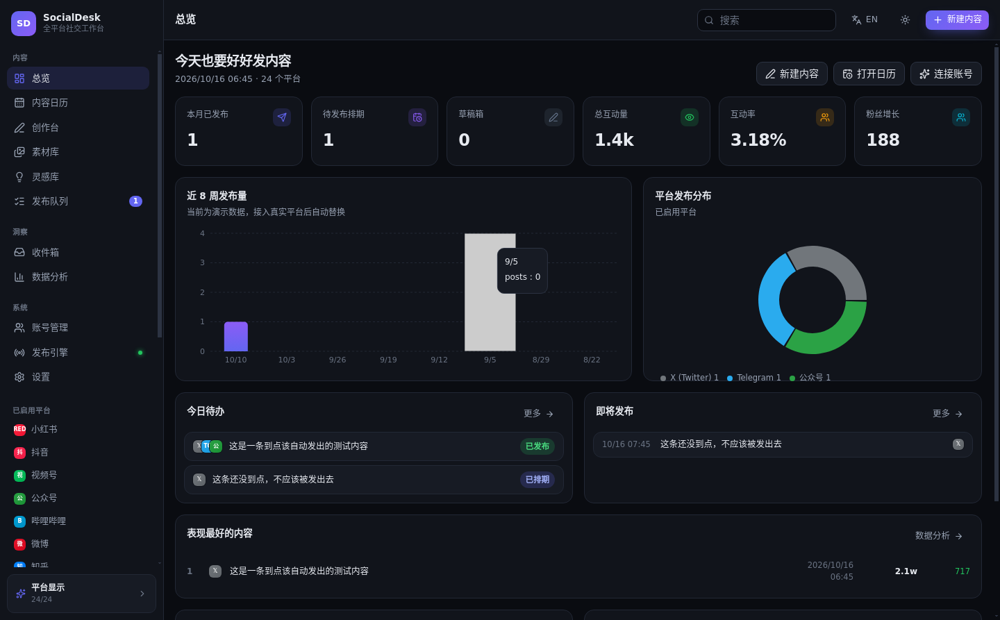
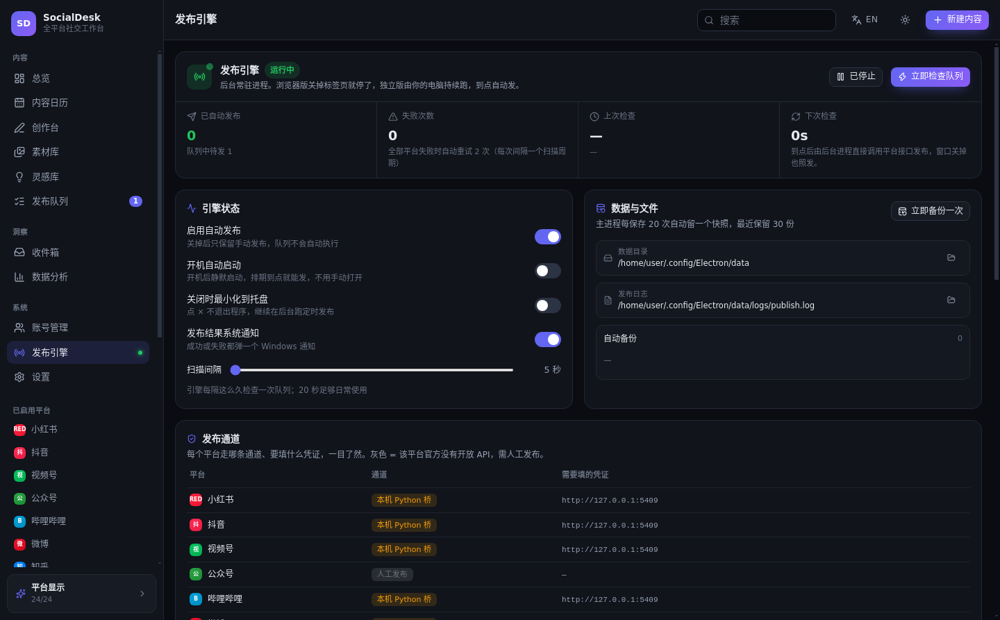
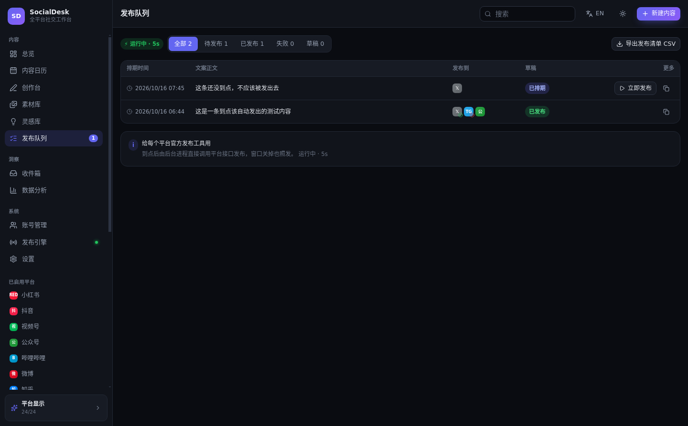
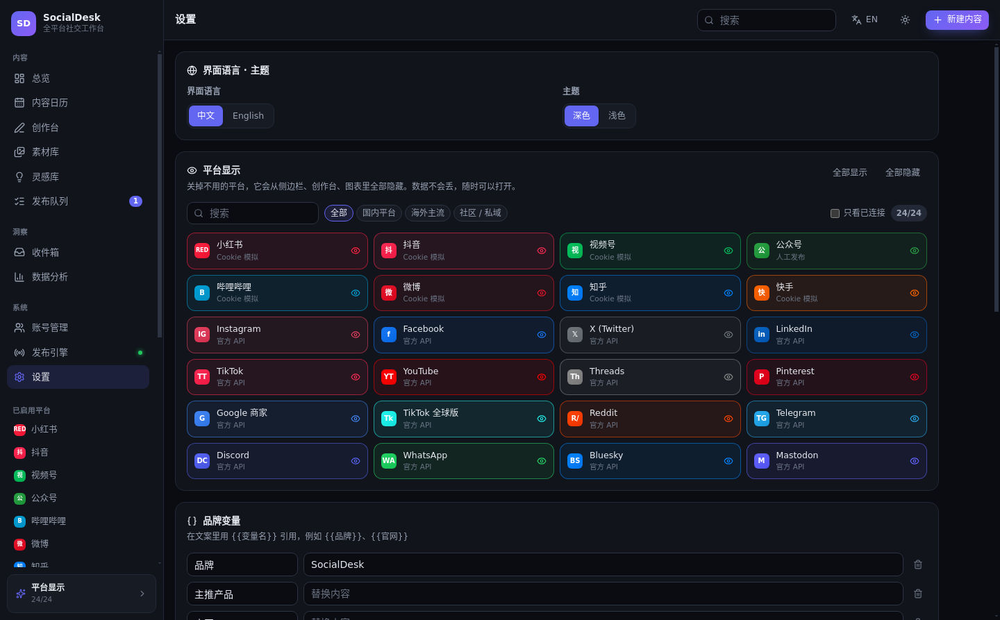

# SocialDesk · 全平台社交工作台（独立桌面版）

> 一个自建的开源社交媒体运营工作台：**24 个平台**、**10 个页面**、**数据全部在你自己电脑上**，
> 后台常驻，**排期到点自动发布**。

从「浏览器里打开的一个 HTML 文件」升级为**真正的桌面应用**（Electron + React + TypeScript）。

---

## 它解决什么问题

商业工具（Hootsuite / Buffer / Later / Metricool / Sprout Social）按席位或频道收费，
一个 3 人团队管 10 个账号一年就要 **$1,200 – $3,564**；而且发布量有配额、数据在别人服务器上。

这个工作台：

| | 说明 |
|---|---|
| 💰 成本 | $0。自带就是全部功能，没有订阅、没有配额 |
| 🔒 数据 | 存在你自己的磁盘（JSON 文件 + 素材目录），不上传任何服务器 |
| 🚀 自动发布 | 后台引擎常驻，排期到点自动发，关机错过的排期下次启动自动补发 |
| 🧩 可扩展 | 加一个平台的发布通道 ≈ 30 行代码，界面自动识别 |
| 🪶 轻量 | 打包后 asar 仅 923 KB，不含任何运行时 node_modules |

---

## 功能一览（10 个页面）

| 页面 | 作用 |
|---|---|
| **总览** | 本月已发 / 待排期 / 草稿 / 互动量 / 近 8 周发布量 / 平台分布 / 今日待办 |
| **内容日历** | 月视图 + 列表视图，**拖拽卡片改期**，按平台/状态筛选 |
| **创作台** | 一份文案**同时预览 24 个平台**的呈现效果、逐平台字数校验、话题标签、首评、素材插入、`{{变量}}` 模板、最佳发布时段推荐 |
| **素材库** | 本地图片/视频上传（**原图落盘，无大小限制**）、网络直链、渐变占位图、标签管理 |
| **灵感库** | 随手记选题，`Ctrl+Enter` 保存，一键转草稿 |
| **发布队列** | 待发/已发/失败分组、立即发布、失败重试、导出发布清单 CSV |
| **统一收件箱** | 评论 / 提及 / 私信汇总，回复、加星、已读管理 |
| **数据分析** | 曝光/互动/点击/涨粉、趋势图、平台对比、最佳时段热力图、内容排行榜 |
| **账号管理** | 多账号接入、凭证管理、每个平台的接入说明 |
| **发布引擎** ⭐ | 后台定时发布引擎：状态总览、通道矩阵、发布日志、自动备份与恢复 |

**设置**里还能：一键隐藏不用的平台（立即从侧边栏/创作台/图表中消失，数据不丢）、中英切换、深浅主题、品牌变量、数据备份/导入。

---

## 界面截图

| 总览 | 发布引擎 |
|:---:|:---:|
|  |  |
| **发布队列** | **设置** |
|  |  |

---

## 支持平台（24 个）

**国内**：小红书、抖音、微信视频号、微信公众号、哔哩哔哩、微博、知乎、快手
**海外**：Instagram、Facebook、X (Twitter)、LinkedIn、TikTok、YouTube、Threads、Pinterest、Google 商家、TikTok 全球版
**社区/私域**：Reddit、Telegram、Discord、WhatsApp、Bluesky、Mastodon

---

## 真实发布的三条通道

发布层是**适配器模式**，一个平台一个模块，换掉它就换了一种发布方式，界面完全不动。

### 🟢 开箱即用（填凭证即可真发）

| 平台 | 凭证格式 | 拿凭证 |
|---|---|---|
| Telegram | `<botToken>\|<chatId>` | @BotFather 建 bot；bot 拉进群后从 `getUpdates` 拿 chatId |
| Bluesky | `<handle>\|<appPassword>` | bsky.app → 设置 → 应用密码 |
| Discord | Webhook URL | 服务器设置 → 整合 → Webhook |
| Mastodon | `<实例域>\|<accessToken>` | 实例首选项 → 开发 → 新建应用 |

支持文字 + **本地素材直传**（图片/视频直接从磁盘读，不经浏览器）。

### 🟡 国内平台：本机 Python 桥

小红书/抖音/视频号/B站/快手**没有开放 API**，业界通行做法是「扫码登录 → cookie → 模拟发布」。
仓库自带 `bridge/social_bridge.py`（**仅用 Python 标准库**）：

```
SocialDesk（桌面程序）  ──HTTP──▶  social_bridge.py  ──▶  各平台
```

编辑 `bridge/config.json` 把发布命令填进去（支持 `{video}` `{content}` `{tags}` 等占位符），
即可对接 [social-auto-upload](https://github.com/dreammis/social-auto-upload) 等现成方案。
详见 [`bridge/README-发布桥.md`](bridge/README-发布桥.md)。

### 🔵 需要 OAuth 的平台（X / LinkedIn / Instagram / YouTube …）

官方要求 OAuth + 应用审核，不适合塞进客户端。填你自己的中转服务 URL，
工作台会把标准 JSON（`{platform, content, hashtags, media[]}`）POST 过去，返回 2xx 即成功。

---

## 快速开始

```bash
# 环境：Node.js 18+
npm install --legacy-peer-deps

npm run dev          # 开发模式（热更新，浏览器打开 http://localhost:5173）
npm run app          # 直接用 Electron 跑（不打包，最接近成品）
npm run build        # 只构建界面 → dist/index.html（单文件）
npm run test:engine  # 端到端测试：排期 → 引擎 → 适配器 → 落库（22 项断言）

npm run dist:win     # 出 Windows 安装包 + 便携版
npm run dist:mac     # macOS .dmg
npm run dist:linux   # Linux AppImage / deb
```

安装版在 `release/`，便携版直接双击运行。

---

## 项目结构

```
├── electron/                    桌面端主进程（独立版新增）
│   ├── main.cjs                 窗口 / 托盘 / 菜单 / IPC / sdmedia:// 协议
│   ├── preload.cjs              安全桥（contextIsolation：界面只能调这里暴露的）
│   ├── scheduler.cjs            ★ 后台定时发布引擎（补发 + 重试）
│   ├── publisher.cjs            发布执行器（逐平台分发、结果落库）
│   ├── db.cjs                   文件数据库（原子写入 + 自动滚动备份）
│   ├── logger.cjs               发布日志（内存环形缓冲 + 落盘）
│   └── adapters/                ★ 发布适配器：一个平台一个文件
│       ├── telegram.cjs  bluesky.cjs  discord.cjs  mastodon.cjs
│       ├── webhook.cjs          通用 webhook 中转
│       └── localbridge.cjs      本机 Python 桥
├── src/                         界面（React 19 + Vite + Tailwind 4）
│   ├── lib/bridge.ts            ★ 桌面/浏览器双模式适配层
│   ├── lib/store.tsx            数据层（桌面走磁盘文件，浏览器退回 localStorage）
│   ├── pages/Engine.tsx         ★ 发布引擎页面
│   ├── platforms/registry.ts    24 个平台的规则（字数/图数/比例/最佳时段）
│   └── i18n.ts                  中英双语文案
├── bridge/social_bridge.py      本机发布桥（国内平台）
├── test/engine-test.cjs         端到端测试
└── electron-builder.yml         打包配置
```

> 💡 同一份界面代码在**浏览器里也能跑**：检测不到 Electron 时自动降级为 localStorage + 演示适配器。
> 这样你既能打包成桌面程序，也能 `npm run build` 出来扔到静态托管上。

---

## 数据存在哪

```
Windows： %APPDATA%\SocialDesk\data\
├── socialdesk.json     主数据库（全部内容、账号、设置）
├── engine.json         引擎配置
├── media/              素材原件
├── backups/            自动备份（保留最近 30 份，可一键恢复）
└── logs/publish.log    发布日志
```

- **换电脑**：设置 → 导出备份（系统「另存为」）→ 新电脑导入
- **手滑了**：发布引擎 → 自动备份 → 点 ↺ 恢复
- 主数据库是纯 JSON，出问题可自己打开改

---

## 技术栈

React 19 · TypeScript 5.9（strict）· Vite 8 · Tailwind CSS 4 · Recharts 3 · Lucide · Electron 33 · electron-builder

---

## 开发约定

- **加一个平台的发布通道**：`electron/adapters/` 新建文件实现 `test()` / `publish()`，
  在 `electron/adapters/index.cjs` 的 `BY_PLATFORM` 挂上平台 id 即可，界面与引擎会自动识别
- **加一个平台**：`src/platforms/registry.ts` 的 `PLATFORMS` 数组加一条，
  它会自动出现在设置页、创作台、侧边栏、日历里
- **改文案**：全部集中在 `src/i18n.ts`

---

## 许可证

MIT。本项目独立编写，未复制任何 AGPL 项目代码。
产品形态参考 [Postiz](https://github.com/gitroomhq/postiz-app)（AGPL-3.0，仅参考）、
[Mixpost](https://github.com/inovector/mixpost)（MIT）；
国内平台 cookie 发布方案参考 [social-auto-upload](https://github.com/dreammis/social-auto-upload)（MIT）。
依赖均为宽松协议，可自由商用。

> ⚠️ 使用 cookie 模拟发布有触发平台风控的可能，请遵守各平台服务条款，建议用小号测试。
